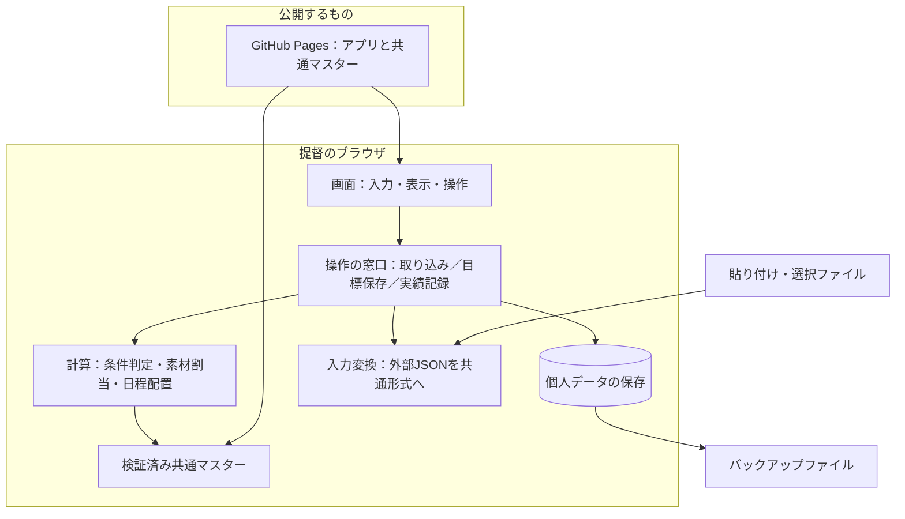
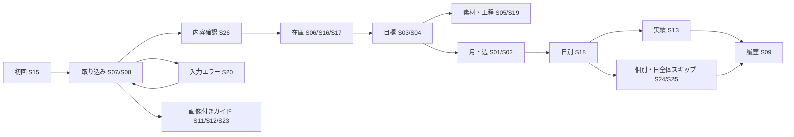

# 01 全体構成 — 変更する場所を分かりやすくする

画面、計算、保存、外部データの読み取りを分離します。画面の色を変える作業で必要素材の計算が変わらないようにするためです。



個人の所持データを公開サーバーへ送る矢印はありません。GitHub Pagesはアプリを配る場所で、提督の在庫を保存する場所ではありません。

## 部品の役割

| 部品 | すること | ここに持たせないこと |
|---|---|---|
| 画面 | 入力、状態表示、警告、画像、操作導線 | 消費数や曜日の独自計算 |
| 操作の窓口 | 検証→計算→保存→再表示をまとめる | 装備別の固定条件 |
| 取り込み変換 | 2経路の入力を読み、種類を識別する | 生レスポンス全体の保存 |
| 条件判定 | 曜日・担当艦・改造段階を判定 | 不明を勝手に不可へ変える処理 |
| 工程作成 | 目標から必要な改修・更新・素材製造を作る | 未検証レシピの推測 |
| 在庫割当 | 保護と予約を考慮し二重使用を防ぐ | ゲーム実行前の実在庫の減算 |
| 日程配置 | 条件に合う日と順番を決める | 資材不足だけを理由に同日予定を移す処理 |
| 保存 | 一括保存、版管理、移行、復元 | 画面ごとに異なる保存ルール |

## ソースの配置案

```text
src/
  app/                  起動・ルーティング・組み立て
  features/             calendar, goals, inventory, import, history, settings
  domain/               recipes, inventory, planning, scheduling, results
  application/          操作をまとめる処理
  infrastructure/       import, storage, master, backup
  shared/ui/            表・警告・画像表示など共通部品
data/master/            公開する共通データ（出典と版を含む）
docs/design/            この設計書
tests/fixtures/         公開可能な架空データ
```

`domain` は画面部品やブラウザ保存APIを直接呼びません。入力を渡すと計算結果が返る形にすると、例題と結果を照合しやすくなります。ユーザーJSONはテスト公開物へ転用しません。

## 画面のつながり



図は実装時に必要な導線です。Penpotのすべてのボタンが実際に動くことを保証する図ではありません。
