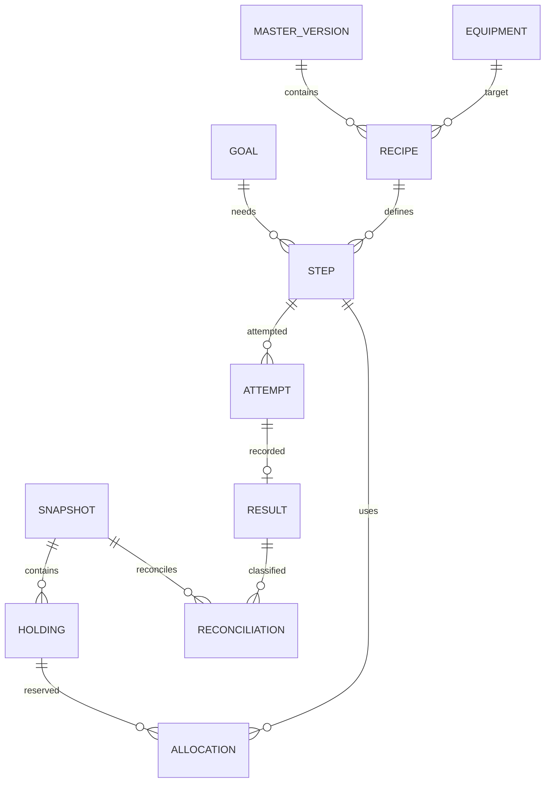
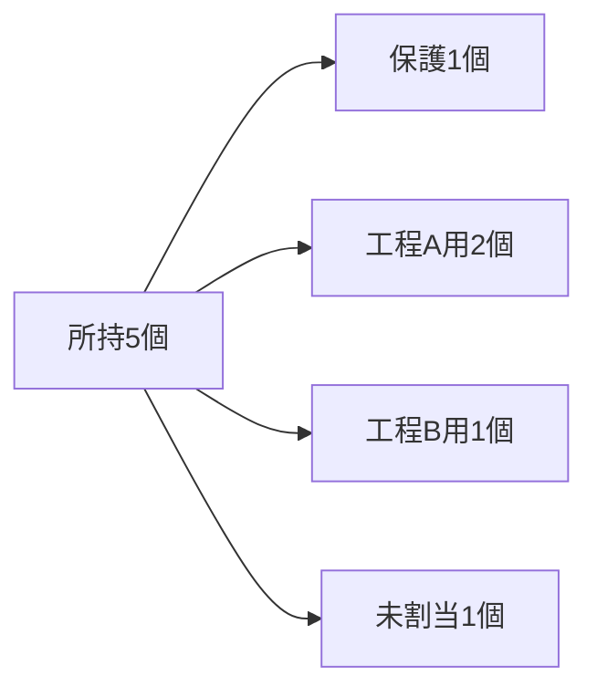

# 02 データ — 事実と予定を分ける

「持っている」「使う予定」「実際に使った」を混ぜない設計です。予定を消しただけで所持数が増減する事故を防ぎます。

## 保存する主なもの

| 名前 | 主な内容 | 例・注意 |
|---|---|---|
| マスター版 | 版、出典、確認日、検証結果 | どの条件で計画を作ったか追跡可能にする |
| 装備・艦娘マスター | ID、正式名、分類、改造関係、画像参照 | 装備IDと艦娘IDを混ぜない |
| レシピ | 入出力、★段階、担当艦条件、曜日、通常/確実化の費用、出典 | 更新先が分岐する場合は別経路として保持 |
| 所持スナップショット | 種類、内容、取得日時、取込日時、入力ハッシュ | 不明な取得日時は空欄。取込日時で代用しない |
| 所持装備 | 装備ID、★、個数、個体IDがあればそのID | id/lvだけの入力にゲーム個体IDを捏造しない |
| 所持艦娘 | 艦娘ID、改造状態、個体IDがあればそのID | 数値IDの名前空間を分離 |
| 所持アイテム | 種類、ID、既知/不明、既知なら数量 | 不明と0は異なる値 |
| 目標 | 装備、目標★、最終個数、優先度、確実化、経路選択 | 追加個数ではなく最終的に残す個数 |
| 保護指定 | 装備/★ごとの保護数、理由 | ゲームのロックを取得できなければ別項目として扱う |
| 工程 | 安定したID、前提工程、レシピ参照、必要物 | 再配置しても同じ工程IDを使う |
| 試行予定 | 工程ID、予定日、順序、状態、警告、計画版 | 失敗した工程は別の試行として再挑戦可能 |
| 実績 | 試行ID、結果、実施日、実消費、訂正版 | 訂正前を履歴に残す。同じ試行に有効結果は1つ |
| 処理管理 | データ版、計画版、最終処理日、処理ID | 二重保存・二重繰越を防ぐ |

## 数量の具体例（架空）

素材Xを5個所持。保護1個、工程Aに2個、工程Bに1個を割り当てたとします。

- 新しい工程に使えるのは1個。
- 工程Aの実行判定では、自分に割り当てた2個を使用可能数から再度引かない。
- 全計画の必要数と比べる場合も、その計画用に確保した分を二重に除外しない。
- 予定段階では所持5個の事実は変わらない。実行した結果を記録して初めて残数を更新する。

画面には「所持」「保護」「この計画の割当」「他の計画の割当」「不足」を用途に応じて表示します。「使用可能」という一語で異なる計算範囲を隠しません。

## 派生データの扱い

不足数・完了見込み・カレンダーは所持/目標/条件から導く結果です。保存する場合は元のデータ版とマスター版を付けます。版が変わったら再計算し、古い計算結果を最新として表示しません。

## インポート後に実績を二重減算しない

取り込んだJSONは対象範囲の最新の所持データとして扱います。取得日時は参考表示に使い、古い・現在・不明の選択は求めません。反映時点までの既存実績は履歴に保持しますが、新しい基準在庫から再減算しません。部分取り込みでは対象外の種類の基準と消費を維持します。

例：所持10個から4個消費した後に10個のJSONを反映すると、最新の所持数は10個です。その後の新しい改修で3個消費すると7個になります。

詳細な基準境界、訂正、保存競合の扱いは [06 在庫照合](06-inventory-reconciliation.md) を参照してください。同じ内容でも新しい取り込み操作として反映します。
