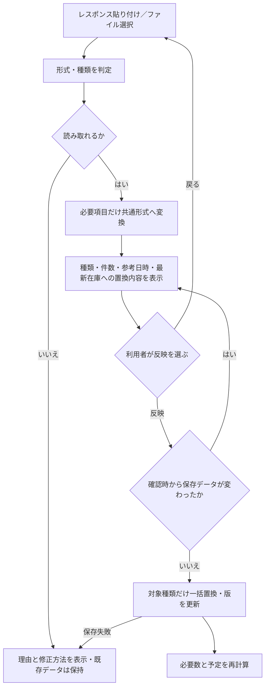
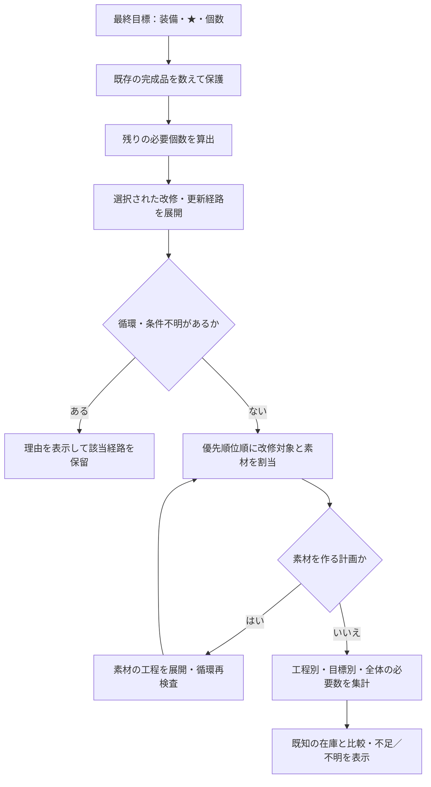
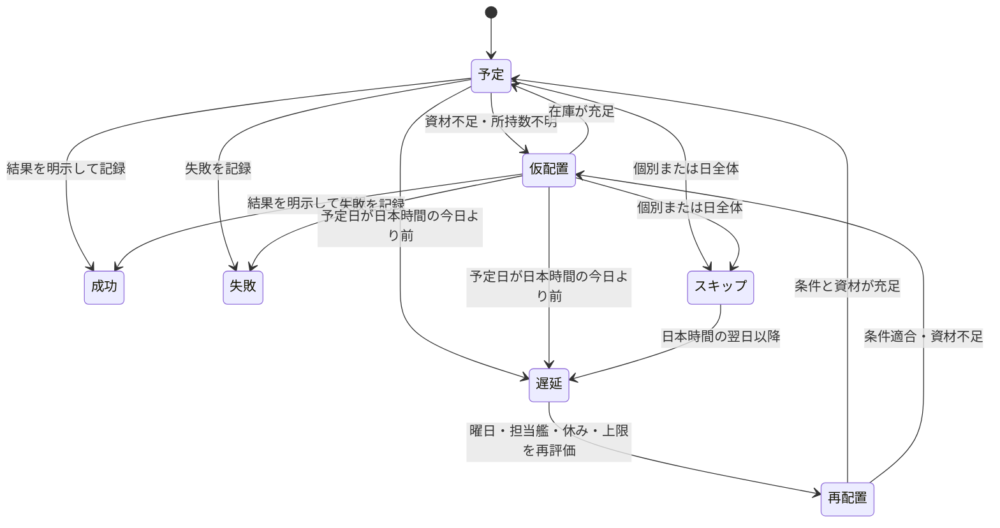
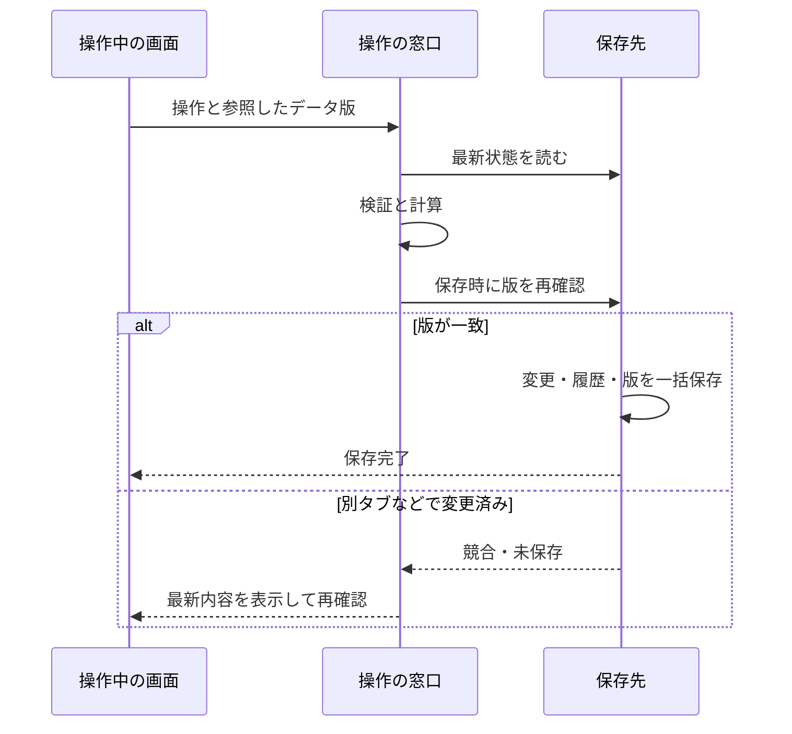

# 03 処理 — 入力から翌日の予定まで

## 取り込み：確認するまでは保存しない

例：装備だけのJSONなら、艦娘と資材を0にせず保持します。初回で保持する情報がない場合は「不明」です。生レスポンスの認証情報は抽出せず、ログや保存先に含めません。

未知IDは黙って捨てず警告し、名称未確定の所持情報として保持する案です。計算への利用は条件が分かるまで保留。数量不正、破損、型不一致は保存を止めます。許容する未知項目と拒否する不正項目は入力形式ごとに定義します。

## 必要数を求める

例：★6の装備を最終的に3個欲しい。★6が1個、★5が2個あれば、必要なのは2個分の★5→★6。既存の★6を素材にしません。費用が架空の1回あたりネジ4個なら、残り必要数は8個です。

通常改修は全成功時の必要数として表示します。成功確率が未確認なら「期待値」を作りません。確実化の設定と失敗後の実績を区別します。

## 日程を組む：不足でも日付を保つ

提案する決定順序：目標優先度 → 前提工程の完了順 → 実施可能な最短日 → 安定した工程ID。乱数で順番を変えず、同じ入力なら同じ結果にします。

1. 前提工程、必要な担当艦、改造段階、改修曜日を確認。
2. 利用者の休みと日別上限を確認。
3. その日までの予定消費を順番に考慮し、必要数を比較。
4. 足りていれば通常予定、不足/資材所持不明なら警告付き仮配置。
5. 担当艦・改修条件を満たせなければ未配置。理由を具体的に示す。

素材の前提工程が完了する前に後続を置きません。同日実施を許す場合は明確な順序と日上限への計上を必須にする提案です。探索に上限を設け、上限に達した場合は「条件不適合」ではなく「探索範囲内で未配置」と表示します。探索期間は09の既定366日を使い、延長可能とします。

## 翌日のリスケ

状態図は予定の概念図です。実装では元の試行・スキップ履歴を消さず、後継の試行予定を作り、元と先をつなぎます。失敗からの再挑戦は別試行として生成します。同日再挑戦は利用者の明示操作のみとし、09/12の上限・順序・後継一意規則で検証します。

例：14日（水）にネジが足りなくても14日に残す。15日（木）になった時点で未実施なら、次の実施可能日へ移す。アプリを17日に開いた場合も、17日現在の条件で未処理分を一度だけ再配置。過去の空き日に実施したことにはしません。

起動、フォーカス復帰、開いている間の日付切替を入口にします。DBの版と最終処理日を確認し、競合時は最新状態から再計算。最終処理日だけでなく処理ID・元試行IDの一意性で重複作成を防ぎます。

## 保存と複数タブ

保存中のボタンは二重押下を防ぎ、完了前に「保存済み」と表示しません。通知だけに排他制御を頼らず、保存時に必ず版を確認します。計算を保存トランザクションの外で行う場合も、この再確認を省略しません。

JSON反映時は対象範囲の最新在庫に置き換え、既存実績を再減算しません。部分取り込みでは対象外の基準を保持します。詳細は06を参照してください。
