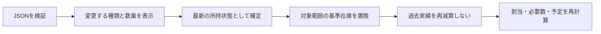

# 06 在庫照合の詳細設計

2026-10-14 / ユーザー指定「JSONで取り込んだデータは最新として扱う」を反映。R05・R11・R12・R20に対応。

## 確定したルール

**反映を確定したJSONを、対象範囲の最新の所持状態として採用する。** 取得日時が不明・古く見える場合も、過去/現在を選ばせない。以前の「時点を選択」「実績ごとに含む/含まないを回答」の案は撤回。

取り込み前に記録した実績は履歴として保持するが、新しい在庫から再度差し引かない。取り込み後の新しい実績だけを増減として反映する。部分取り込みでは対象外の在庫基準も計算結果も維持する。

## 数字で追う例（架空）

| 操作 | 最新基準と実績 | 結果 |
|---|---|---:|
| ネジ10個を取り込む | 基準10 | 10 |
| 消費4個の改修を記録 | 基準10−新実績4 | 6 |
| ネジ6個のJSONを取り込む | 基準6へ置換。前の消費4は履歴のみ | 6 |
| ネジ10個のJSONを再び取り込む | 指定に従い最新10へ置換 | 10 |
| その後、消費3個を記録 | 新基準10−新実績3 | 7 |
| 装備だけのJSONを取り込む | 資材基準は変更しない | ネジ7を保持 |

古いファイルでも取り込み内容を最新として採用する。取得日時による独自の優先順位を付けない。確認画面では「取り込み内容で現在数を置き換えます」と表示し、変化する数量を事前に見せる。

## 保存する項目

| データ | 主な項目 | 用途 |
|---|---|---|
| 基準在庫 | snapshotId, scope, entries, importedAt, sourceCapturedAt?, inputHash | 最新として確定した内容。取得日時は参考情報 |
| 基準境界 | scope, snapshotId, includedThroughSequence | この基準へ重ねない既存実績の範囲 |
| 実績 | eventId, attemptId, originalSequence, revision, deltas, occurredDateJst, historyOnlyScopes | 実施日と記録順を分ける |
| 操作記録 | operationId, expectedRevision, resultingRevision | 同じ操作の再送・別タブ競合を防ぐ |
| 割当 | planVersion, sourceSnapshotIds, reservations | 古い在庫に基づく割当を検出 |

境界はカテゴリまたは更新対象IDの範囲ごとに持つ。装備全件置換と、資材の一部ID更新を区別。ID欠落を勝手に0にせず、アダプターが確認した全件範囲だけを置換する。

## 計算と訂正

`見込み所持数 = 最新基準値 + 元イベントのoriginalSequenceが基準境界より後の、有効な実績増減（historyOnlyScopesと基準取込済み下書きは除外）`。

- 予定・スキップ・訂正前の実績は増減に含めない。
- 取り込み後に作成した実績を訂正：旧増減を除いて訂正版を適用。10−4=6を消費3へ訂正すると7。
- 取り込み前の実績を訂正：履歴だけ訂正し、新基準在庫は増減させない。訂正版の記録順が新しくても、元イベントが基準以前なら再適用しない。
- 取り込み前に実施した記録漏れを後から追加：「最新JSON取得前の実績」として履歴のみ記録するモードを用意。通常の新規実施と区別し二重減算を防ぐ。これはJSONの鮮度を選ばせる操作ではない。
- 入力途中に別タブで取り込み：保存版不一致を検出し、最新状態からプレビューを作り直す。
- 在庫が負になる新実績：不整合項目を表示し確定を止める。未記録の入手や所持更新を案内する。

達成数は最新所持から数える。古い成功実績を足して完成品を水増ししない。消えた改修対象や素材の割当は再検証。保護数が所持数を超えても黙って保護を減らさず、該当装備を確認待ちにする。

## 保存手順

1. 入力検証後、現在の保存版で種類別差分を作る。
2. 反映確定時に保存版を再確認。他タブ更新があれば差分を作り直す。
3. 対象範囲の新基準・基準境界・操作記録・保存版を1トランザクションで確定。
4. 割当・予定を再計算。失敗時は「在庫保存済み・計画再計算待ち」と明示し、再試行を可能にする。

同じoperationIdの再送は既存結果を返す。同じJSONでも新しい取り込み操作として確定されたら最新基準として採用。ハッシュ一致だけで無視しない（途中の実績後に同数へ戻っている場合がある）。

## 入力の粒度と検証

個体IDありなら同じ個体の二重割当を禁止。id/lvのみなら装備ID＋★の集計で配分し、ゲーム個体IDを捏造しない。粒度変更時は保護と割当を再構築して曖昧な対応を表示する。

上の数値例、同一操作再送、同一内容の新操作、部分取込、過去実績訂正、履歴専用記録、別タブ競合、保存失敗、再計算失敗、保護数超過、個体/集計切替を検証する。残数だけでなく基準ID・範囲別境界・履歴・処理回数を確認。ここでの例題は設計検証で、アプリの実装テストは未実施。

下書きのscope別基準包含と在庫保留は12を参照。原イベント順を訂正時に変えない。sequenceは実施日順ではなく保存時の単調増加順序。新JSON反映前に存在する実施済み下書きも対象scopeへ包含し、再減算しない。

## 保護不一致の解消契約（第7巡、R05/R12）

保護の指定値と現在所持への有効な割当を分ける。所持2個に対する旧指定3個を保持しても、在庫や保護済み実数を3個と表示しない。「指定3／現在2／確認待ち」と表示する。

- 取込で不一致を検出した時点で、対象bucketまたは対応不明の個体群にreconciliationRequiredを設定する。新JSONと同じトランザクションで保存し、再読込・別タブでも保留が消えないようにする。
- 保留中は対象群から新規素材割当を作らない。既存の未実施素材割当は無効として再検証し、当日は日付を維持して確認待ちにする。実施済み履歴は取消さない。影響しない装備の計算は続行できる。
- 完成条件を満たす最新所持は数量として表示可能。ただし個体対応が不明な目標の作業対象や予約先を黙って確定しない。目標の不足と保護の確認待ちを別表示する。
- 手動保護数変更は最新所持以下の整数を受け付ける。目標由来保護は別の理由として残す。同じ集計枠に重なる保護は和集合にし、数量だけを単純加算しない。変更前後の有効保護総数と素材利用可能数をプレビューする。
- 個体入力では利用者が対象個体を選ぶ。集計入力では装備ID＋★ごとの数量指定。粒度変更でゲーム個体IDを推測して復元しない。集計保護への変換を明示した場合に限り対応を確定する。
- 解消コマンドResolveProtectionはdatasetEpoch/expectedRevisionと対象snapshotIdを検証する。別の取り込みがあれば旧プレビューで保存せず再表示する。保護指定・解消状態・planDirtyを一括保存。再計算が失敗しても保存済み指定は維持し、旧割当を新しいものと扱わない。
- 「今は保留」は不一致を解消しない。保護指定の減数、在庫の巻き戻し、暗黙の素材解禁を行わない。バックアップには未解消状態と旧指定値も含める。

例：所持2、手動指定3、目標割当1。手動指定を2へ変更し、目標の1枠をその2枠に重ねれば有効保護は2、素材利用可能は0。手動指定を0へ変更しても目標保護1は残り、他の保留・予約がなければ素材利用可能は1。
