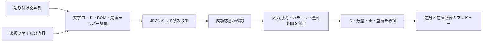

# 07 取り込みと画像付きガイドの詳細

対象：Chrome/Edgeのレスポンス貼り付け、74式EN **5.4.3** のファイル選択・ドロップ。利用環境を増やさない。

## 74式EN 5.4.3でソース確認できたこと

利用バージョンはユーザー回答。公式タグ5.4.3のコミットは `9a61d31c4ec574342f23a306aad47f9d3af769e3`。以下はその版のコードを読んだ結果であり、実機での操作確認ではない。

- 接続設定には `Save API data`、保存場所、`Request`、`Response` のチェック項目がある。
- このアプリに渡すのはResponseの保存ファイル。Requestの保存は不要。
- 応答ファイル名は時刻部分に続く `S@` とAPIパスを含み、パスの `/` は `@` に変換され、拡張子は `.json`。
- リクエストファイルは `Q@` で区別される。
- SaveResponseは取得した本文をUTF-8で書き込む。JSONの純粋な本文に整形してから保存する実装ではないため、入力側は `svdata=` の有無とUTF-8 BOMを扱う。
- 保存先は設定値を使用。ガイドでは固定フォルダだと断定せず、画面に表示された保存場所を確認してもらう。

出典：

- [5.4.3 接続設定の画面定義](https://github.com/ElectronicObserverEN/ElectronicObserver/blob/9a61d31c4ec574342f23a306aad47f9d3af769e3/ElectronicObserver/Window/Settings/Connection/ConfigurationConnectionUserControl.xaml)
- [5.4.3 応答保存処理](https://github.com/ElectronicObserverEN/ElectronicObserver/blob/9a61d31c4ec574342f23a306aad47f9d3af769e3/ElectronicObserver/Observer/APIObserver.cs#L1125)
- [5.4.3 英語ラベル](https://github.com/ElectronicObserverEN/ElectronicObserver/blob/9a61d31c4ec574342f23a306aad47f9d3af769e3/ElectronicObserver/Properties/Window/Dialog/ConfigurationResources.en.resx)

## パーサーの入口

入力テキストを実行しない。先頭の既知ラッパーのみ除去し、本文中の同じ文字を一括置換しない。JSON構文エラーは位置と修正方法を表示し、レスポンス全文をエラーログへ出さない。ファイル名は種類の補助情報であり、本文検証を省略する根拠にしない。

### 全件と差分

| 入力 | 設計上の扱い |
|---|---|
| 装備id/lv配列 | 装備のみのスナップショット候補。個体ID・ロック情報なし |
| 対応確認済みの装備全件API | 装備カテゴリ全件。個体IDと改修値を検証 |
| 資材APIの既知ID/値 | 提供された資材IDの値を更新。欠落IDを0にしない |
| 艦娘の一覧・母港等 | APIごとの全件/差分の仕様をアダプターで固定。未確認のAPIは自動全件置換しない |
| その他アイテム | APIの省略規則を検証後に全件範囲を確定。欠落=0の推測をしない |
| 空配列 | 種類と全件性が確定できる場合のみ0件として確認可能。それ以外は判定不能 |
| 複数ファイルが同じ種類 | 取得時刻・範囲を並べて対象を選択。ファイル順や更新日時だけで最後勝ちにしない |

1回の取り込み操作の上限値（サイズ・ファイル数）は実例を測定して決める。大きすぎる入力は保存前に拒否し、分割方法を案内。未知IDの警告と不正数量の拒否は区別する。

## スクリーンショットの撮影表

| 経路 | 必要な実画像 | 注釈 | 状態 |
|---|---|---|---|
| Chrome | Networkの対象通信、Response、Copy response | ①対象行 ②レスポンス ③コピー | 未撮影 |
| Edge | 同じ操作の画面 | 表示差がある箇所を個別説明 | 未撮影 |
| 74式EN 5.4.3 | 接続設定のSave API data・Response・保存先 | ①保存有効 ②Response ③保存場所 | ソース確認済み・未撮影 |
| 74式EN 5.4.3 | 実際のS@ファイル | 対象API、取得日時、Q@との区別 | 未撮影 |
| アプリ | 貼付/ドロップ、差分確認、照合、反映完了 | 各画面1操作ずつ | Penpot設計は存在、実装アプリ未作成 |

画像は1操作1枚、等倍で読める解像度、クリック拡大、番号と短文をセットにする。トークン・Cookie・ユーザーID・個人フォルダ名は載せない。必要なら安全な架空データの操作例を撮影するが「実際の利用者データ」と呼ばない。設定画面の実画像をAIで捏造しない。

## ゲーム画像の設計検討用素材

Penpot S03に12.7cm連装砲・12.7cm連装高角砲・12.7cm連装砲B型改二、S16に睦月改二・睦月・吹雪改、S22に睦月と12.7cm連装砲の実画像を配置。所持状態・担当条件・改修費用の実例を示すものではない。

| 画像 | 参照元 | 確認 |
|---|---|---|
| 睦月 | [KC3Kaiの画像](https://github.com/KC3Kai/KC3Kai/blob/6b0534d291c27220da1b6fe454e91fc96a6a7b27/src/assets/img/ships/1.png) | マスター艦娘ID1=睦月を照合。画像258×172 |
| 12.7cm連装砲 | [艦これ攻略Wiki 装備カード一覧](https://wikiwiki.jp/kancolle/装備カード一覧) のweapon002-b.png | カード名称と表示を照合。画像390×390 |

KC3KaiのソフトウェアライセンスがMITであることと、元ゲーム画像の公開再配布許諾は別。今回の設計検討用配置を、公開配布条件の確認済みと扱わない。画像は公開リポジトリ・配布アプリにはまだ追加していない。

公開時の画像対応表には、ゲームID、種別、改造/季節差分、出典、取得日、ハッシュ、サイズ、利用条件確認の記録、差し替え先を持つ。代替画像は未所持・画像欠損・条件不適合を混同しない。

## 最新データとしての反映

確定したJSONは対象範囲の最新在庫として扱います。取得日時は参考情報です。S27は反映数量と保持対象の確認のみとし、過去・現在・不明の選択を求めません。既存実績の消費を再減算しません。詳細は06を参照してください。
