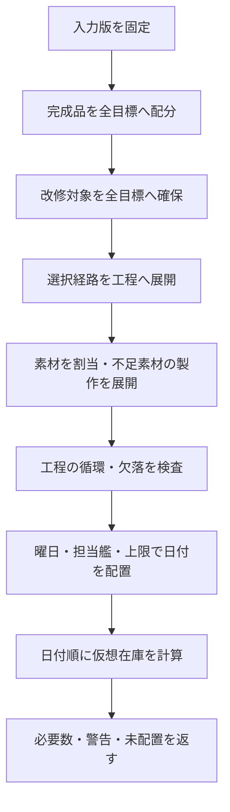

# 09 必要数・在庫割当・日程計算の詳細仕様

2026-10-14。R08〜R19/R21、A04〜A08に対応。ユーザー確定要求を守るための実装仕様案。以下の既定値と配分規則は設計判断であり、ゲームの実仕様を示すものではない。未確定だった同種目標・素材利用順・同日工程を本書で具体化する。

## 入出力を固定する

計算は保存や現在時刻の取得を行わない純粋な処理とする。同じ入力なら同じ工程・割当・配置を返す。

| 入力 | 内容 |
|---|---|
| 基準 | inventoryRevision、goalRevision、settingsRevision、masterVersion、todayJst |
| 所持 | 06で投影した装備・資材・艦娘、既知/不明、保護 |
| 目標 | goalId、装備ID、targetStar、count、matchMode、priority、routeId、確実化規則 |
| 予定 | 既存試行、結果、日別実施回数、スキップ、移動禁止の当日予定 |
| 設定 | 曜日別上限、休みの日/閉区間、探索期間 |
| 出力 | 工程DAG、割当台帳、必要数、配置、警告、未配置理由、入力版セット |

数量は非負の安全な整数。★は0〜10、★MAXは10として正規化。更新による出力★はレシピの明示値を使用。個体IDとマスターIDは別の型とし、装備・艦娘・資材・その他アイテムの名前空間を分離する。

## 目標数量は独立した「残したい個数」

同じ装備の複数目標を許可し、数量は加算する。★6以上2個と★10を1個なら、合計3個を残す。1個を両目標の完成数に数えない。登録画面で合計を明示する。同じ装備・★・一致方式の重複は既存目標への数量追加を提案するが、黙って統合しない。

matchModeの既定はatLeast（★以上）、exact（完全一致）も選べる。完成品配分は制約の厳しいexactを先に、次にatLeastの★が高い順、同条件は優先度・作成順・goalIdで決定。atLeastへは条件を満たす最小★から配る。これにより★10が必要な目標に★10を残す。これは完成数の配分規則であり、日程の優先順は利用者のpriorityを使う。

手動保護は素材への消費を禁止する指定。条件を満たす完成品として数えることは可能。手動保護と完成品保護が同じ個体なら重複加算せず、保護対象の集合を取る。集計入力でも内部の配分枠に重ねて紐付ける。目標削除時はその目標由来の保護だけを外し、手動保護は残す。

## 改修対象を素材より先に確保

全目標の完成品を確保した後、全目標の未完成の改修対象をpriority順に確保する。その後に素材を割り当てる。低優先度の改修対象を高優先度の素材として消費しない。

選択した経路上にある既存装備のうち完成状態に近い候補を先に使う。並び順は残工程数、装備ID、★の降順、個体IDまたは内部配分枠の安定キー。ここでの最短は工程数であり、最小ネジ・最短日数を保証しない。

個体入力ではinstanceIdを保持。id/lv集計入力ではbucketKey=(equipmentId,star)と数量枠を使い、内部枠IDをゲーム個体IDと表示しない。入力の粒度が変わったら自動的な個体対応を推測せず、目標対象・保護を再照合する。

## 経路と素材の割当

- レシピは入力装備状態、出力状態、通常/確実化費用、素材の適合条件、曜日と担当艦条件を持つ。素材の★条件を推測しない。
- 更新分岐や複数経路があるときは利用者がrouteIdを選ぶ。経路未選択を恣意的な最安経路で補わない。
- 必要素材には既存の未保護・未割当の適合装備を先に使う。許容範囲内で低い★、次に安定ID順とする。改修済み装備も素材になり得るので、★付き消費を確認画面に列挙する。
- 素材の不足には「製作経路を選ぶ」「別途入手」を持たせる。既定は別途入手として不足表示。対応する製作経路を選べば不足数量だけ子工程を展開する。開発・ドロップを自動的な確定入手にしない。
- 子工程の出力は消費先工程に予約し、他目標へ重複配分しない。1回の出力数はレシピ値を使う。
- 循環検出は装備IDだけでなく状態とrecipeIdを持つ展開経路で行う。再帰スタック上の再出現を循環とする。別枝で同じレシピを使うことは循環ではない。
- 初期の計算保護上限は深さ100・展開工程10,000。超過はCOMPUTATION_LIMITとして部分計算を表示し、完成不能と断定しない。計測後に値を変更可能にする。

工程IDは目標の個数枠・経路・段階・素材の枝から安定的に導く。日付だけの変更でIDを変えない。経路変更時は旧工程を廃止として残し、結果履歴の参照を削除しない。

## 二重計上しない集計

工程費用は各工程1回だけ合計する。子工程の費用を親の小計に含めた表示を、全体合計に再び足さない。更新元や改修対象は「作業対象」であり、素材の消費と別欄にする。

| 表示 | 算出 |
|---|---|
| 残り必要数 | 有効な未完了工程の選択モードの費用合計 |
| 使用可能所持 | 実在庫から手動/完成品/改修対象保護と対象外計画の予約を除く。自計画予約は除かない |
| 不足数 | max(0,残り必要数−使用可能所持−その需要へ予約された計画製作品) |
| 不明 | 所持または費用が未取得。不足を0と表示しない |
| 計画内製作品 | 装備だけに適用する将来出力。現所持とは別欄 |

計画全体の資材は共有在庫と一度だけ比較する。各目標の不足の単純合計は全体不足にしない。目標別の不足を表示するときは優先順位で割当後の不足と明記する。

通常改修を含む数値は全成功時の必要数。期待値や将来の自然回復・任務報酬を追加しない。実際に失敗した消費は実績へ移り、未完了工程に再挑戦費用が必要になる。

## 日程の配置規則

探索範囲の既定はtodayJstから366日（今日を含む）。設定で延長可能。範囲外はSEARCH_LIMITであり改修不可ではない。日付はJSTのYYYY-MM-DDで比較し、OSのローカルタイムゾーンに依存させない。

1. 既存の当日予定・実績・休みを先に固定する。
2. 各日を昇順に走査し、その日に実施可能で全前提を満たす工程を候補にする。
3. 候補を目標priority、同目標内の前提順、工程の安定ID順で選択。
4. 空き枠へ配置するたびに、その日の候補を更新。前提と後続の同日実施を許すが別枠を消費し、前提を先にする。
5. 担当艦はレシピに明示された曜日と艦娘/改造段階の組で照合。「改二なら改の条件も満たす」などの推測は禁止。候補が複数なら艦娘ID・個体ID順。所持だけで運用可を示す設計であり、疲労・遠征・損傷状態は未取得なら保証しない。
6. 資材・消費装備の不足は日付候補から除外せず、仮配置する。改修対象そのものが未所持で作成経路もない場合はTARGET_MISSINGとして未配置。
7. 配置できない親の後続はPREDECESSOR_BLOCKED。別途入手する素材の不足は仮配置の警告とし、製作予定の素材には前提関係を必須にする。

日別上限は「試行回数」。成功・失敗は1回、未実施予定も枠を1つ予約。スキップ当日はその枠を空けて自動補充しない。日全体スキップはその日の新規自動配置を禁止する。通常の再計算でもこの制約を保持する。

仮想在庫は日付・日内順に実在庫から費用を減算し、前提工程の計画出力を加算する。負数を内部では保持し、各時点の累積不足を示す。毎回0に丸めると後続の不足を過小評価する。前提が仮配置なら後続にもPREDECESSOR_TENTATIVEを継承する。実在庫は変更しない。

## 再計算と日付移動を分離する

取り込みや在庫変更では当日の日付・順番を保ち、充足表示だけを更新する。当日予定の対象消失や条件不成立は「当日予定・確認待ち」として実行不可にし、別日へ自動移動しない。将来分は新条件で再配置する。目標削除・利用者が明示した編集は対象予定を取消せるが、実績は保持する。

新しい目標は残りの空き枠へ配置可能。スキップで凍結した枠を再利用しない。失敗直後の自動再挑戦は翌日以降に置く設計とする。同日再挑戦は利用者が明示的に追加し、残り上限と前提を検証する。R16の「不足・スキップは翌日」の自動処理とは区別する。

未配置理由は複数保持する：HELPER_UNKNOWN、HELPER_MISSING、REMODEL_MISMATCH、RECIPE_UNKNOWN、ROUTE_REQUIRED、TARGET_MISSING、CYCLE、PREDECESSOR_BLOCKED、NO_AVAILABLE_DAY、SEARCH_LIMIT、COMPUTATION_LIMIT。素材不足は警告でありこの一覧と混同しない。

当日の前提失敗・スキップ時の後続停止、結果下書きの回数・在庫保留、当日上限の変更は[12](12-state-reconciliation.md)の規則を適用する。

確実化の段階・更新・素材工程への適用、未配置時の完了日は17-guarantee-and-calendar.mdで定義。

利用者が工程の希望担当艦を選んだ場合はその指定を優先し、不適合時は確認待ち。未指定のみ候補の安定順を使う。表示操作はui-design-v1.mdの担当艦候補を参照。

## 担当艦別素材の展開（2026-10-17）

R11/R12/R13/R19。担当エントリで素材装備・アイテムが異なる場合、希望担当を決めてから不足素材とその製作工程を展開する。鎖の消費を調べる前に工程キーを割り当て、希望指定をその工程へ対応させる。目標本体の全鎖、または一回の素材製作で作る全鎖を段階・生成順で割り当てる。既存の生きた工程番号は予定日・日内順で引き継ぎ、取消済みを含む使用済み番号を新規枠へ再利用しない。工程キーの書式は変更しない。

日程候補は、素材展開に用いたエントリと素材が同じ候補に絞る。担当に不適合なら別の担当へ黙って切り替えない。資材だけが異なる候補では、実際に配置したエントリの費用で集計する。

当日固定は日付・実行順・試行IDを維持する。利用者が明示指定した希望担当が当日の所持・改造段階・曜日に適合する場合、同じ枠で担当と素材を変更する。不適合の場合は既存担当のエントリの費用を保持し、確認待ちにする。同じ担当に曜日別のエントリがある場合も、固定日の曜日に一致するエントリを使う。担当・エントリ・表示費用を食い違わせない。

`helper-materials.test.ts` の合成例、実出典ID121/267の10段階、`e2e/helper-materials.spec.ts` の当日・将来の選択から実績確定までで検証する。ゲーム自体の実機確認とは区別する。
