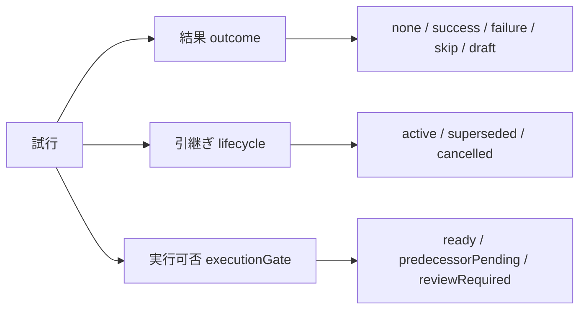
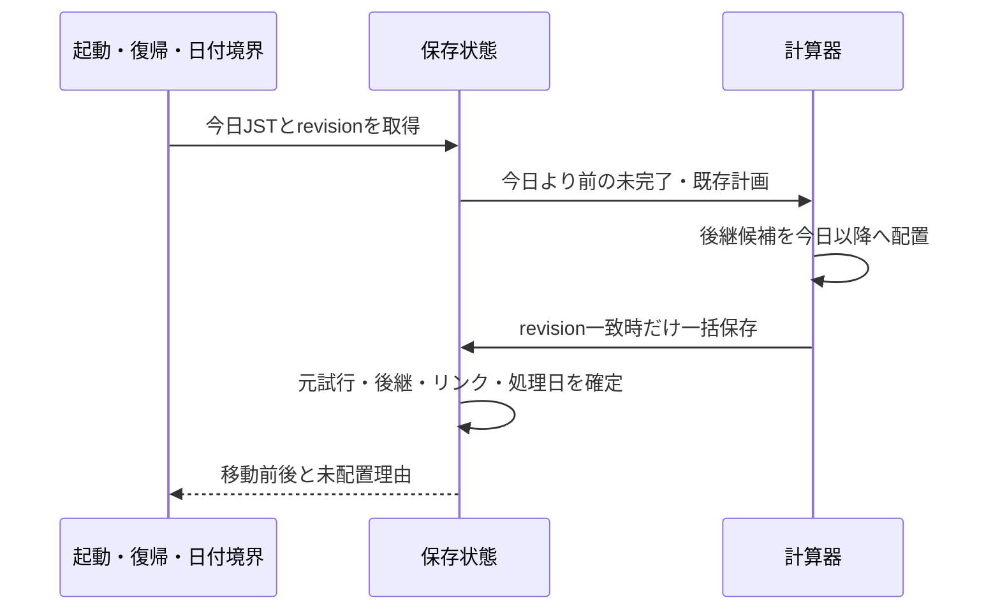

# 10 操作・実績・翌日処理・保存の詳細仕様

2026-10-14。R02〜R05/R15〜R20、A01/A02/A06〜A10。06の最新JSON規則と09の日程計算を前提とする。DB製品に依存しない処理契約を先に定める。

## 操作の共通契約

すべての更新はdatasetEpoch、commandId、expectedRevision、writerVersion、payloadを受ける。commandIdは利用者の1回の確定操作に発行し、失敗後の再送で再利用する。新しく同じJSONを反映する場合は別commandId。

戻り値はAPPLIED（保存版と変更対象）、ALREADY_APPLIED（既存結果）、CONFLICT（最新版本）、VALIDATION_ERROR（項目別理由）、STORAGE_ERROR（再試行可否）。保存完了前に成功表示しない。UIの二重押下禁止だけに頼らない。

| 操作 | 検証・変更対象 |
|---|---|
| ImportInventory | 対応形式・全件範囲・数量を検証。対象基準とscope別境界を置換 |
| SaveGoal/DeleteGoal | 目標・経路参照・個数を検証。保護と派生計画を無効化、過去実績保持 |
| SetProtection | 所持以内の保護。最新取り込みで超過した既存保護は確認待ちで保持 |
| SetAvailability | 上限は非負整数、日付区間の逆転禁止。将来分を再計算 |
| RecordResult | 有効な試行・前提・実消費を検証。実績と対象装備遷移を原子的に保存 |
| CorrectResult | 旧版と訂正版を保持。有効版を1つにし、後続との矛盾を検査 |
| SkipAttempt/SkipDate | 当日の未実施のみ。増減なし、枠を凍結、翌日まで移動しない |
| ProcessRollover | 過去の未完了を一度だけ再配置 |
| RestoreBackup | 全体検証・移行後に一括置換。復元前の状態を失敗時に保持 |

## 保存モデルの補足

| 保存単位 | 主な制約 |
|---|---|
| meta | singleton、datasetEpoch、revision、schemaVersion、minimumWriterVersion、nextSequence、lastProcessedDateJst、planDirty |
| baselines | scopeKeyごとに現在の基準1つ。値、coverage、includedThroughSequence、includedDraftIds |
| resultEvents | eventId、originalSequence、revision、有効版。訂正でもoriginalSequenceを変更しない |
| attempts | attemptId、stepId、scheduledDate（未配置はnull）、dayOrder、outcome、lifecycle、executionGate、predecessorAttemptId? |
| commandReceipts | (datasetEpoch,commandId)一意。commandType、canonicalPayloadHash、保存結果。業務保存と同一トランザクション |
| successorLinks | 元試行の後継関係。activeNextAttemptByStepで同工程の有効な次回試行を最大1つにする |
| plans | 入力版セットと計算結果。現版本と一致しなければ古い計画 |

範囲はequipment全件、ships全件、resource:ID、item:IDなど明示キーで管理。全件性が未確認の入力は全件置換に使わない。取り込みと実績は同じ更新順序で直列化し、先に保存された実績だけが新基準に含まれる。

## 実績の状態を計画の警告と分離

試行の結果none/success/failure/skip/draftと、引継ぎ状態active/superseded/cancelledを独立して保存する。以下の図は操作の概念図。詳細な保存・訂正・後継の契約は12-state-reconciliation.mdを正本とする。資材不足はwarning、遅延は日付と未完了から導く。

| 操作 | outcome | lifecycle | その他 |
|---|---|---|---|
| 初回配置 | none | active | 不足はwarning、前提未完はpredecessorPending |
| 成功/失敗確定 | success/failure | active | 結果終了。新規結果の上書きは訂正コマンドのみ |
| 当日スキップ | skip | active | 無消費。当日は予約枠保持 |
| 翌日繰越 | 元のnone/skipを維持 | 元をsuperseded | 後継はnone/active |
| 下書き保存 | draft | active | 消費保留。自動繰越対象外 |
| 予定取消 | none/skipを維持 | cancelled | 実績を持つ試行の取消は訂正として扱う |

成功・失敗・下書きはlifecycle=activeでも未実施予定には数えない。日付nullの未配置は日付比較による繰越対象ではなく、通常の再配置計算で扱う。

成功時は入力状態を1個減らし、レシピの出力状態を増やす。改修対象自体の状態遷移と、別途消費する素材を二重に減らさない。個体識別の継続は入力API仕様に従い、更新後のゲーム個体IDを推測しない。

失敗時は★進行なし。失敗時消費がソースで確認済みなら候補値を表示し、利用者が確定する。不明ならUNKNOWNとし、成功時費用をコピーしない。項目ごとの実消費入力で数量を確定する。確認不能なら下書きとして保持し、結果確定と計画更新は保留する。下書きは実績消費に数えず、翌日処理では「結果確認待ち」として自動再試行を保留する。

新実績の消費で既知在庫が負になる場合は確定を止める。不明在庫からの消費は不明のまま履歴に残せるが、残数が算出できないことを表示する。実際にゲームで行ったかをJSONの差分だけで推定しない。

## 過去の記録と訂正

06の境界判定はeventのoriginalSequenceで行う。新基準より前の実績の訂正は履歴のみ変更し、現在在庫に反映しない。取り込み後に追加する記録漏れは、最新JSONより前の実施なら対象scopeをhistoryOnlyにする。部分取り込みのためscopeごとに判定し、資材だけ更新済みなのに装備側の補正まで捨てない。

成功Aを失敗へ訂正すると、Aの出力を使った成功Bと矛盾し得る。この場合、Bを無言で削除・失敗に変えない。依存する結果一覧を表示し、関連訂正を一括検証できるまで確定を止める。訂正が現在基準以前で在庫を変えない場合も、履歴の依存矛盾は明示する。

予定の取消は結果の取消ではない。日付だけの変更で実績を移動しない。訂正後は有効版だけを集計し、古い版の消費を合算しない。

## 日本時間で翌日になった時の処理

対象はscheduledDateがnullではなくtodayJstより前、outcomeがnoneまたはskip、lifecycle=active、有効後継なし。過去の失敗には既に再試行があるか確認し、別ルートで重複生成しない。

何日閉じていても、今日から一度だけ置く。閉じていた各日に架空試行を作らない。後続予定は同じ再計算で前提順序を守る。担当艦不在なら後継を未配置にし、元とのリンクを残す。候補が見つからない場合も元試行を処理済みにして、次回はその未配置後継を再計算する。

lastProcessedDateだけを省略判定に使わない。同日中の過去日記録訂正などで新たな未処理対象が出たら再走査する。2タブが計算してもrevision検査と後継一意制約で1つだけ保存する。端末時刻が後退しても実績・処理を巻き戻さず警告。外部時刻サーバーには依存しない。

## 計算失敗と競合

在庫などの事実保存時にplanDirty=trueを同時保存する。計算はトランザクション外で入力版を固定して行い、結果保存時に再度版本を比較。一致時だけ新計画へ切り替える。不一致なら結果を破棄して再計算する。旧結果を新しいものと表示しない。

計算が失敗しても保存済み在庫を戻さない。「在庫保存済み・計画再計算待ち」と表示し再試行可能にする。再計算待ちの古い計画から実績を確定する場合は、最新在庫・前提を再検証する。通知APIは再読込の合図であり排他制御ではない。

## バックアップと移行

バックアップはschemaVersion、作成日時、所持基準/境界、実績全版とrecipeSnapshot、結果下書き、工程定義、目標、保護、設定、試行/後継、マスター版参照を含む。生APIレスポンス・認証情報は含めない。派生計画は再計算可能なので必須としない。

復元はサイズ・構造・数量・参照整合・対応schemaVersionを保存前に検証。未知の新しい版は拒否し、現データを保つ。旧版は純粋な移行手順を順次適用して全体検証後に置換。更新失敗・容量不足は全体取消。

復元は「JSON在庫取り込み」と異なり、保存時点の全体状態を復元する。復元を最新在庫取り込みとして境界を書き換えない。ローカルrevisionは復元前より進め、古いタブの保存を拒否。復元成功後に今日の繰越と再計算を行う。削除/置換前に既存状態のバックアップ保存を案内する。

## エラー表示

エラーはcode、fieldPath、利用者向け日本語、再試行方法を持つ。JSON本文や認証値をログへ載せない。PARSE_ERROR、UNSUPPORTED_SHAPE、INVALID_QUANTITY、AMBIGUOUS_SCOPE、REVISION_CONFLICT、STORAGE_FULL、CALCULATION_FAILED、BACKUP_VERSION_UNSUPPORTEDを区別する。未知マスターIDは警告付き所持として保持し、未検証の改修条件で自動計画しない。

## レビュー修正の詳細
繰越後の過去記録、当日前提失敗、結果下書きとJSON再取込の整合は[12](12-state-reconciliation.md)。APIごとの取込範囲は[13](13-import-contracts.md)。

旧版レシピの履歴保存、バックアップ必須項目、復元前タブの排除は[14](14-master-and-backup-contract.md)を適用する。

## 訂正検証の範囲（第6巡）
最終残数の非負だけでは、使用時点に存在しない前提出力を消費した矛盾を検出できない。訂正の影響先は直後の工程だけでなく、出力利用先を推移的にたどる。実施順はoccurredDateJst/occurredOrder、基準への包含判定はoriginalSequenceであり、互いに代用しない。

各実績の入力状態、出力元、素材割当を検査し、実施済み後続の前提を失う訂正は一括訂正が整合するまで保存不可。外部で入手した同種素材への付け替えは明示操作とし、当該実施時点の根拠を記録する。現在所持だけから過去時点の入手を推測しない。

基準以前の在庫を最新JSONから逆算して捏造しない。過去の数量履歴が不足していれば「履歴の数量検証不能」を表示し、証明できる依存矛盾と区別する。現在在庫の増減対象scopeについては06の有効増減を用いて計算し、既知在庫を負にする訂正を拒否。基準包含済みscopeは履歴訂正のみで、現在数が負になるという架空のエラーを作らない。

訂正前後と影響する全試行・保留・後継・scopeを同じexpectedRevisionで検証し、確定は1トランザクション。途中失敗ならすべて元の状態を保持。例題と机上確認は18を参照。

ResolveProtectionは06の保護不一致を解消する明示コマンド。単なるSetProtectionとは異なり、粒度変更の対応確認とreconciliationRequiredの解除を含む。共通の再送・revision契約を適用し、対象snapshotIdも検証する。保留中の素材割当を有効としない。

## 再送判定の処理順（第10巡）

1. 入力の基本形・writer互換性・datasetEpochを検証する。復元前epochの要求は拒否し、14の規則を優先する。
2. 現epochのcommandReceiptsを検索する。同じcommandIdでcommandTypeと正規化payloadのハッシュも一致すれば、保存時のexpectedRevisionが古くてもALREADY_APPLIEDと保存済み結果を返す。既存結果を再実行しない。
3. 同じcommandIdで内容が異なる場合はCOMMAND_ID_REUSEDとして拒否する。単なる二重押下と混同しない。確認画面で内容を編集して確定し直す操作には新commandIdを発行する。
4. 未処理のcommandだけexpectedRevisionを現revisionと比較する。相違ならCONFLICT。最新データで再確認後は新commandIdで確定する。
5. 業務検証・業務保存・成功receiptを同じトランザクションで確定する。容量不足などの失敗では成功receiptも残さない。

payloadハッシュは正規化済み業務項目とcommandTypeを対象にし、JSONのキー順や表示用ファイル名には依存させない。原文・認証情報をreceiptへ保存しない。expectedRevisionは再送で同じ値を保つが、payloadの業務内容と混同しない。

更新scopeなしのImportInventoryはAPPLIEDのresultKind=NO_CHANGE、changedScopes=[]、現在revisionを返せる。この場合もcommand再送の識別用receiptは保存可能だが、在庫revision・境界・planDirtyを変更しない。13の空入力契約に従う。

復元成功でepochが変わった後に復元commandの応答が失われた場合、旧epochを再適用してはならない。UIは現epochと復元結果を再読込して確認し、旧画面の自動再送を停止する。通常更新のALREADY_APPLIED経路と区別する。

### 補完する操作一覧
| 操作 | 主な契約・参照 |
|---|---|
| SaveDraftResult | 実施確認必須。同試行の下書き更新、日別回数重複なし、scope保留。12 |
| CancelDraftAsNotPerformed | 理由必須、履歴保持、保留/回数解除、後継再検証。12/06 |
| ResolveProtection | 最新snapshot照合、指定と不一致解消を一括保存。06 |
| RequestSameDayRetry | 明示追加、日上限と前提・有効次回試行の一意性を検証。09/12 |
| SetPreferredHelper | 当該曜日・レシピ適合を検証。不適合時の黙示代替禁止。09 |
| ApplyMasterVersion | 検証済み版のみ適用、planDirty、当日日付保持。14 |

これらにも共通再送契約を適用する。RecordResultが下書きを確定する場合、下書き消去・実績保存・保留解除を一括処理する。

### 再送の検証例
| ID | 状況 | 期待 |
|---|---|---|
| P63 | revision7で保存成功し8へ。応答消失で同じ要求を再送 | ALREADY_APPLIED。競合扱いにせず消費は1回 |
| P64 | 同commandIdで消費4から3へpayloadを変更 | COMMAND_ID_REUSED。既存実績を変更しない |
| P65 | トランザクションが容量不足で失敗後、同要求を再送 | 成功receiptなし。他更新がなければ通常再試行可能 |
| P66 | 更新scopeなしを同commandIdで再送 | NO_CHANGEの既存結果。基準境界・在庫revision不変 |
| P67 | 復元成功直後に応答消失、旧epochで再送 | 旧要求拒否。再読込で現在状態を確認、二重復元しない |

期待契約であり、DBやブラウザでの実行済み結果ではない。

## 保存後の再表示失敗と日付境界（2026-10-17）

R02/R16/R20、A07/A09/A10。保存と、その後の読み直しは別の処理とする。読み直しだけが失敗した場合は、保存失敗と断定せず、入力を保持して同じ確定の再送を案内する。

実績・訂正・確認待ち・過去記録では、最初の確定押下時に受付ID・確定日時・前提の版・payload全体を固定する。日付確認や別タブ通知で表示データが更新されても、同じ入力の再送には元の要求を用いる。日付が翌日になったために、受付済みの記録を過去記録画面へ切り替えたり、新しい日付・計算結果で送ったりしない。受付記録があればALREADY_APPLIEDとなり、消費と訂正履歴を増やさない。

利用者が入力や種類ごとの回答を変更したときは、新しい受付IDを発行する。変更前の要求を黙って送信しない。保存済みデータと版が異なれば競合を知らせ、再確認する。最初の未保存操作が日付をまたいだ場合は従来どおりDATE_CHANGEDで拒否する。

追加した合成データのE2Eは `e2e/release-readiness.spec.ts` に記録し、実ゲームの確認とは区別する。
