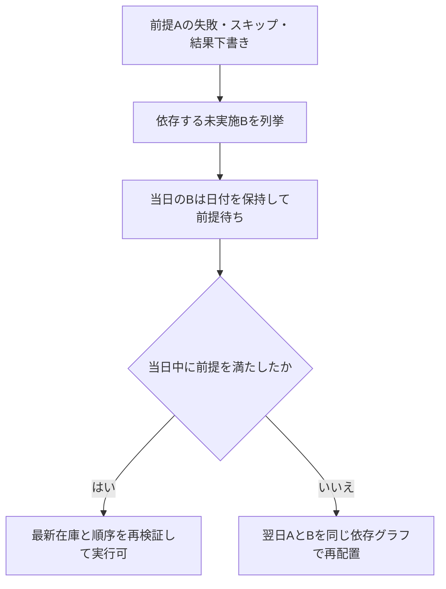

# 12 実績と後継予定の整合・結果確認待ち

2026-10-14 / 設計レビュー第1巡の修正。R05/R14〜R20、P09〜P18を補完。10の状態遷移と併せて適用する。

## 繰越後の過去実績を記録する

元試行がsupersededでも過去の実績は記録できる。試行の「結果」と「予定の引継ぎ状態」を独立した項目とする。結果はnone/success/failure/skip/draft、引継ぎ状態はactive/superseded/cancelled。スキップ履歴をsupersededで上書きしない。

1. 元試行と同工程の全後継、素材出力の利用先を読み、expectedRevisionを固定。
2. 元試行の成功を追記する場合、結果未記録の後継は取消候補とする。日付が今日でも「不足による繰越」ではなく重複予定の取消なので可能。
3. 後継に成功・失敗・結果下書きがある場合は、自動取消しない。異なる実試行なのか誤記なのか確認する競合画面を表示。対象装備・入力状態・実施順の整合を検証するまで一括保存を止める。
4. 結果、取消、素材割当の解放、後継リンクの更新を同一トランザクションで保存。
5. 元試行の失敗を追記した場合は工程未完了。適合する既存後継を再利用し、新規に同じ再挑戦を作らない。

新基準より前の履歴のみ記録でも、成功後に不要になった後継予定は照合する。ただし最新JSONが示す装備状態を過去成功で書き換えない。現在の所持から目標が未達なら、その差を埋める新工程を明示して生成する。消えた完成品を古い履歴から復活させない。

同じ工程に対する有効な未実施の次回試行は最大1つ。後継種別ごとの一意制約だけでは不足するため、activeNextAttemptByStepを工程単位で一意にする。失敗再試行と翌日繰越はこの同じ制約を使用する。

## 前提工程が当日に失敗・スキップした場合

Bを自動で成功・失敗・スキップに変更しない。予定の警告とは別にexecutionGate=predecessorPendingを設定し、記録確定時も前提を再検証する。Bの予約枠は当日保持。資材不足の仮配置は実施不能の断定ではないが、存在しない前提出力の使用は許可しない。

利用者がAを同日再挑戦して成功した場合、Aの実施順はBより前でなければならない。別途入手した素材でBを行いたい場合は「計画製作を取りやめ、既存在庫を使用」の明示操作で経路・予約を変更し、在庫検証する。単に画面から記録ボタンを押して前提を飛ばせない。

当日上限を変更して既存試行数を下回った場合は既存事実・予定を消さず、超過を表示して追加配置を止める。今日を休みに変えた場合も日付は保持して実施不可と表示し、翌日処理へ回す。利用者による明示取消は別操作。

## 結果下書きの保存契約

下書きは「実施したが消費などを確定できない記録」。単にフォームを入力中の状態とは別。保存時に実施済みであることを明示確認する。

draftResults: draftId、attemptId（一意）、occurredDateJst、occurredOrder、reportedOutcome、knownConsumptions、unknownFields、createdRevision、updatedRevision、inventoryBoundaryAtCreation。バックアップに含める。

- 下書き保存は実施日の日別試行回数に1回算入する。既存の予定予約と二重には数えない。
- 実在庫と★は確定変更しない。ただし「実績未確定のため残数未確定」を表示。既知消費と不明消費を計画用の保留として確保し、他工程がその在庫を確定充足として再利用しない。不明消費の対象カテゴリの充足判定は不明へ落とす。
- 自動再挑戦とその出力に依存する後続は確認待ち。翌日になっても勝手に再試行を作らない。
- 下書きを再開し必要項目が揃ったらRecordResultとして同一試行へ確定。下書きの削除・実績保存を一括実行し、試行回数を増やさない。
- 「実施していなかった」と取消す操作は理由と訂正履歴を保存し、回数と保留を解放。過去日の未実施に戻った場合は繰越対象として再評価する。
- 下書き後にJSONを取り込んだ場合もJSONを最新として採用。新JSONの更新対象scopeでは、反映前に存在する実施済み下書きをincludedDraftIdsへ自動的に含める。そのscopeの在庫保留も解除し、その後の確定で二重減算しない。未更新scopeの保留は維持する。JSONに過去/現在の選択を求めない。取り込み後に追加する過去実績だけはhistoryOnlyScopesを明示する。

## 繰越・訂正の追加例

| ID | 操作 | 期待 |
|---|---|---|
| P23 | 昨日のAを今日のA2へ繰越後、昨日成功を追記 | A2未実施なら取消。1工程が重複して残らない |
| P24 | 同じ状況でA2に結果あり | 自動取消なし。矛盾一覧と一括訂正へ |
| P25 | 同日A→BのAをスキップ | Bを当日に保持して前提待ち。翌日に依存順で再配置 |
| P26 | A失敗後に同日再挑戦成功、B未実施 | 日上限と実施順を確認してBの前提待ち解除 |
| P27 | 上限2で成功1回と下書き1回 | 追加試行枠0。下書き確定後も2回 |
| P28 | 消費不明の下書き、JSONで資材10更新、下書き消費4確定 | 対象scopeが基準に含まれるなら10を維持。非更新scopeは個別判定 |
| P29 | 下書きを未実施として取消、予定日が過去 | 訂正履歴を残し、後継は最大1つ |

## 必要な画面と操作

S13には「実施済み・消費確認待ちで保存」と再開導線を追加。S09には下書きと繰越前試行を表示し、過去記録の追記を可能にする。競合ダイアログは元試行・後継・実施日・入力出力・影響する在庫scopeを並べ、未解決なら確定不可。日別S18は前提待ちと不足仮配置を別の理由で表示する。これらの画像反映はレビュー記録で別に追跡する。
