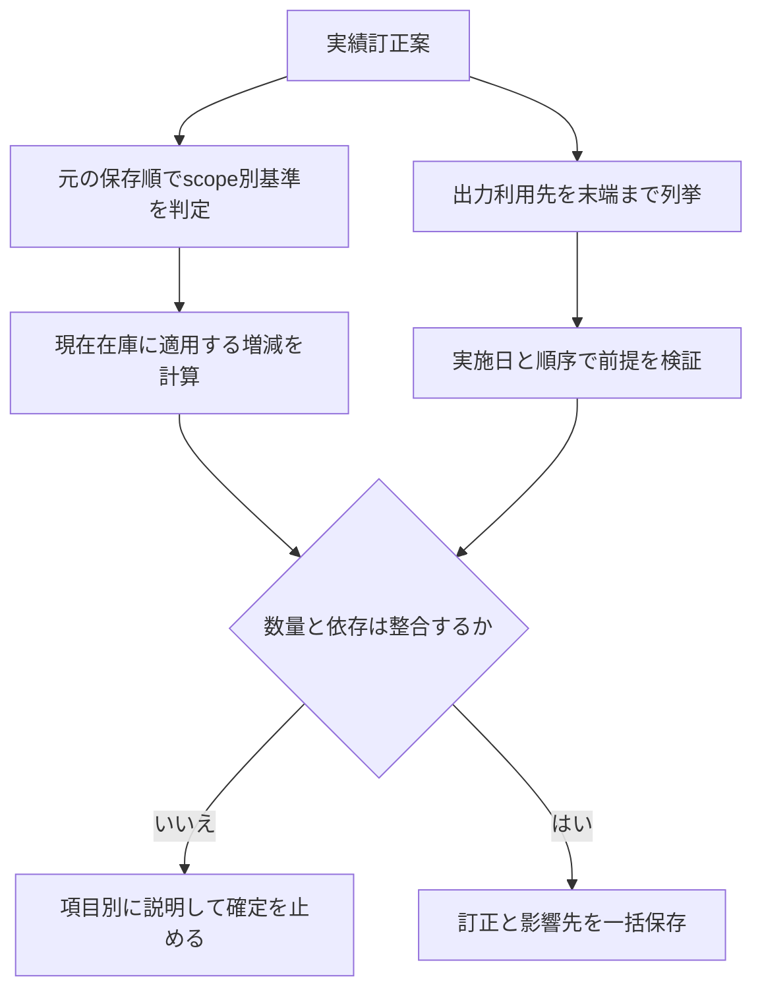

# 18 訂正と基準境界の机上監査

2026-10-14。R05/R12/R20。文書の規則を具体例へ適用した監査。アプリの実行テストではない。ゲームの消費値は架空。

## 実施順と保存順を混同しない

## 手計算で確認した例

| ID | 入力・操作 | 規則を適用した結果 | 確認 |
|---|---|---|---|
| P45 | 資材基準10、seq1消費4、seq2消費3。seq1を消費2へ訂正 | 10−2−3=5。旧消費4を重ねない | 06/10と一致 |
| P46 | P45の訂正前に資材8を再取込、境界seq2。その後seq1を消費2へ訂正 | 最新8を維持。訂正版の新revisionを新消費として数えない | 06と一致 |
| P47 | 資材だけ境界seq2。装備の境界seq0。seq1成功で装備A→B、資材4消費。成功を失敗へ訂正 | 資材は最新値維持。装備はB−1/A＋1へ訂正。B使用済みなら関連結果の解決まで保存不可 | scope別の判定が必要 |
| P48 | A出力をBが使用、B出力をCが使用。A成功を取消 | BだけでなくCも影響一覧。B/Cを無言で削除しない | 直後のみの検査では不足。10へ明文化 |
| P49 | B実施後にAを成功として記録。Bの素材はA出力指定 | 最終数量が0以上でも実施順が逆なら確定不可。外部入手を推測して補完しない | 保存順と実施順を分離 |
| P50 | 基準以前のA成功訂正。過去在庫履歴はなく、依存矛盾も確認できない | 現在数は維持。過去数量は検証不能と表示し、架空の逆算をしない | 最新JSON優先と整合 |
| P51 | 同じ工程に失敗再試行と翌日繰越が同時作成候補 | 種別が違っても有効次回は1つ。revision競合または一意制約で二重保存を防ぐ | 11の古い不変条件を修正 |

P47の数量訂正は装備scopeが基準以後の場合だけ。資材の更新日時を装備にも流用しない。P48/P49は現在在庫の充足とは独立した履歴の依存検証。

## 実装時に必要な証拠

各例について訂正前後の有効イベント、originalSequence、scope境界、数量、後継件数、競合時の無変更をアサートする。P48は3段以上の依存、P49は保存順と実施順が異なる入力、P47は異なるscope境界を必須にする。最終残数だけのテストでは不足。

## 残る設計・外部確認

保護再照合、scope別過去実績、担当艦選択の全状態の画面化、PC幅別の目視、復元完了までのプロトタイプ、実機ガイド画像、useitem省略規則、全件マスター照合、失敗時消費の事実確認。今回の机上監査をこれらの完了証拠にしない。

## 保護再照合の追加例（第7巡）
| ID | 操作 | 期待 |
|---|---|---|
| P52 | 手動保護3、目標保護1、最新所持2。手動を2へ変更 | 重複を含む有効保護2、素材0。所持は2のまま |
| P53 | 同じ入力で手動を0へ変更 | 目標保護1を維持。他の予約なしなら素材1 |
| P54 | 確認画面を開いた後に別タブで所持1へ更新 | 旧所持2に対する確定を拒否。新しい差分へ戻る |
| P55 | 保留を選び再読込、またはバックアップ復元 | 所持は最新基準、指定不一致は未解消、素材利用を解禁しない |

P52/P53は和集合の数量を机上確認。P54/P55は実装時に検証する期待契約であり、ブラウザ実行済みではない。
