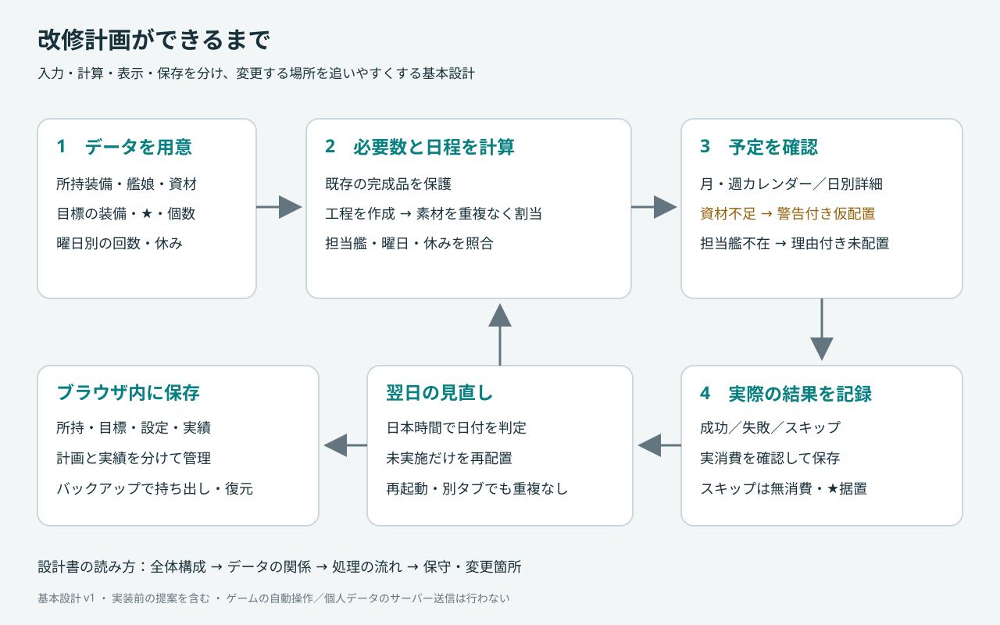
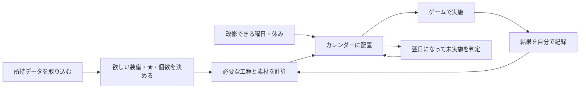

# 艦これ改修スケジューラ 設計ガイド

2026-10-14 / 基本設計 v1 / 実装前

このアプリは「何を、いつ、誰を担当艦にして改修するか」と「あと何が必要か」を整理します。ゲームそのものの操作は行いません。実装はClaude、設計とレビューはCodexが担当します。

## 最初に見る図

「資材が足りない」と「改修条件を満たせない」は異なります。資材不足は黄色い警告付きの仮予定、担当艦不在や条件不明は理由付きの未配置です。

## 読む順番

| 知りたいこと | 読む文書 |
|---|---|
| アプリの部品と役割、なぜ分けるか | [01 全体構成](01-architecture.md) |
| 何を保存し、どう関連するか | [02 データ](02-data.md) |
| 取り込み・計算・翌日処理の動き | [03 処理](03-flows.md) |
| 変更場所、更新手順、決める必要があること | [04 保守と判断記録](04-maintenance.md) |
| UIレビューで何を直したか | [05 UIレビュー](05-ui-review.md) |
| 再取り込みや実績訂正で在庫を壊さない仕組み | [06 在庫照合の詳細設計](06-inventory-reconciliation.md) |
| 74式EN 5.4.3の保存形式と画像付き手順 | [07 取り込みと画像ガイド](07-import-and-image-guide.md) |

これは基本設計の初稿です。要求の正本は `docs/requirements.md`、画面仕様は `docs/ui-design-v1.md`、技術候補は `docs/technology-selection.md` です。図の例はすべて架空で、実際の改修費用・担当艦・曜日を表しません。

## 決定と提案の区別

**決定済み**：JSONを最新の対象在庫として反映し既存実績を再減算しない、PC向け、同期・ログインなし、GitHub Pagesで公開、Chrome/Edgeの貼り付けと74式ENのファイル取り込み、資材不足の仮配置、日本時間の翌日リスケ、ゲーム画像と画像付きガイドを使う要求。

**設計提案**：責務分割、保存形式、在庫と実績の照合方式は09〜18に具体化しています。同じ装備の複数目標は独立した個数を合算し、1個を重複計上しません。設計例の机上確認と実装テストを区別します。ゲーム画像の調達・公開利用条件、実機ガイド、技術候補の採用とバージョンは未確定です。

## 言葉の早見表

| 言葉 | 意味 |
|---|---|
| マスター | 全装備、艦娘、改修条件など、全員に共通の情報 |
| スナップショット | ある時点の所持情報を写したもの |
| 工程 | ★5から★6への1回など、計画を構成する作業 |
| 割当 | 同じ装備を二度使わないよう、使用先を予約すること |
| 実績 | 成功・失敗・スキップを記録した事実 |
| トランザクション | 関連する保存を全部成功か全部取消にそろえる仕組み |
| 版 | どの状態を元に計算したかを区別する番号 |

## 最初の実装順

取り込みと保存 → 在庫・目標 → 必要数計算 → カレンダー → 実績と翌日処理 → ガイド・画像 → 実機確認。見た目だけの完成を、実データで使える完成とは扱いません。

## 内部処理仕様（2026-10-14）
- [09 必要数・割当・日程計算](09-planning-engine.md)：目標の数え方、素材製作、日別配置、仮想在庫。
- [10 操作と保存](10-commands-and-persistence.md)：実績、訂正、翌日繰越、競合、バックアップ。
- [11 数値例と検証](11-processing-examples.md)：手計算例、22ケース、不変条件、実装順。

09〜11で既存文書の未確定だった内部処理を具体化した。09〜11の既定値・選択規則は設計判断であり、ユーザーの明示要求とゲーム条件マスターを優先する。旧文書の同種目標統合・同日工程・探索期間の提案と競合する場合は09〜11を参照する。

## 設計レビュー対応
- [12 実績・後継・下書きの整合](12-state-reconciliation.md)
- [13 API入力と更新範囲](13-import-contracts.md)
レビューは継続中。useitemの省略規則は未確認です。旧マスター復元の処理契約は14、確認画面はS32にありますが、復元完了までのプロトタイプは未完です。残件は../implementation-status.mdを参照してください。

- [14 マスター・履歴・復元](14-master-and-backup-contract.md)
- [15 修正と再レビューの記録](15-review-log.md)

- [16 要求R01〜R23の監査](16-requirements-audit.md)
- [17 確実化とカレンダー集計](17-guarantee-and-calendar.md)

- [18 訂正と基準境界の机上監査](18-correction-audit.md)
